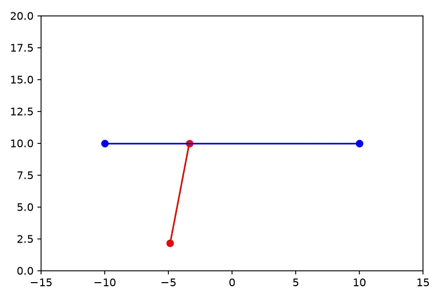

# Inverted Pendulum

<p align="center">
  
</p>

This project uses a **linear quadratic regulator (LQR)** and an **energy-based swing-up controller** to balance an inverted pendulum by only actuating the pivot left and right.

## Installation

Requires Python 3.10+.

```bash
git clone https://github.com/ltriv131/inverted-pendulum.git
cd inverted-pendulum

python -m venv .venv
source .venv/bin/activate      # Windows: .venv\Scripts\activate

pip install -e .
```

This installs the dependencies (NumPy, SciPy, and Matplotlib).

## Usage

```bash
python -m inverted_pendulum
```

A Matplotlib window opens and shows the pendulum swinging up and balancing. The terminal logs controller mode switches and simulation timing.

## How It Works

### LQR Balancing

The LQR uses a linearized state-space model of the pendulum's dynamics, with the state being:

- pivot position
- pivot velocity
- pendulum angle
- pendulum angular velocity

### Energy-Based Swing-Up

Because this linearization only holds for angles near the reference, another controller is needed to swing the pendulum up to angles close to inverted. To do this, I calculate the pendulum's total mechanical energy and its desired total mechanical energy, and then find which acceleration direction would cause the correct change to the pendulum's energy.

This method gets the pendulum near 0, but isn't precise enough to balance the pendulum, which is why we hand off to the LQR.

## Takeaways

This project was helpful since I solidified my understanding of LQRs, along with their benefits and limitations. It was also fun to solve the dynamics of the pendulum and model it using state space.

## Future Work

- Find ways to incorporate noise in the output (in a more well-thought-out way than I currently have implemented it)
- Experiment with state estimation for this system
